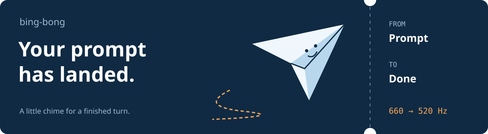
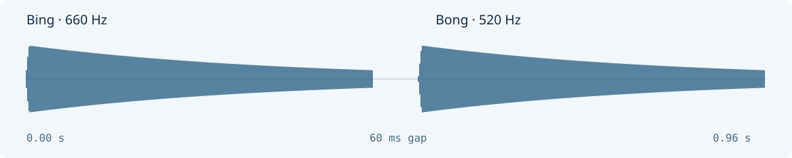
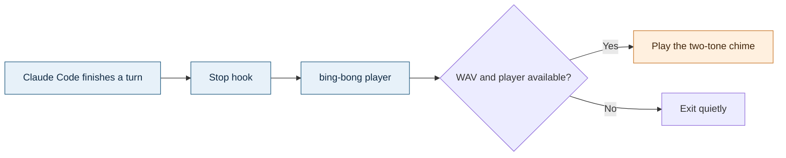

# bing-bong ✈️

**Your prompt has landed.** An airline-style seatbelt chime plays when Claude Code finishes responding, so you can look away from the terminal and hear when the turn is done.

**[🔊 Listen](sounds/seatbelt-chime.wav)** · **[⌨️ Install](#install)** · **[🧭 Hook flow](#flow)** · **[🎛️ Customise](#customise)** · **[🧳 Uninstall](#uninstall)**

## 🔊 Two notes. One small notification.



**[Play or download the bundled chime](sounds/seatbelt-chime.wav)** — 0.96 seconds, mono, 44.1 kHz, 16-bit WAV.

The sound is synthesized from scratch in [`make_chime.py`](make_chime.py): a descending **660 Hz → 520 Hz** pair. The waveform above comes from the actual bundled file. No copyrighted airline recording is included.

<a id="install"></a>

## ⌨️ Board from the terminal

Use a Bash environment with Python 3 and one of the audio players listed below.

```bash
git clone https://github.com/Piyushmishra29/bing-bong.git
cd bing-bong
./install.sh
```

The installer copies the sound, creates a portable player, registers the Stop hook, and plays a test chime. It can be rerun to update an older chime hook.

| Installed item | Purpose |
|---|---|
| `~/.claude/sounds/seatbelt-chime.wav` | The notification sound. |
| `~/.claude/sounds/bing-bong` | A small Bash player that chooses an available audio command. |
| `~/.claude/settings.json` | Receives the Stop hook that launches the player in the background. |

<a id="flow"></a>

## 🧭 From finished turn to chime



The installer registers the equivalent of this [Claude Code hook](https://docs.anthropic.com/en/docs/claude-code/hooks):

```json
{
  "hooks": {
    "Stop": [{
      "hooks": [{
        "type": "command",
        "command": "$HOME/.claude/sounds/bing-bong &"
      }]
    }]
  }
}
```

The `&` makes playback asynchronous. Player output is suppressed; a missing sound file or missing audio command exits quietly. The installer writes the resolved player path into the actual settings file.

### 🎧 Audio-player fallback order

The installed script tries the first available command in this order:

| Priority | Player | Typical environment |
|---|---|---|
| 1 | `pw-play` | PipeWire |
| 2 | `paplay` | PulseAudio |
| 3 | `afplay` | macOS |
| 4 | `aplay` | ALSA |
| 5 | `ffplay` | FFmpeg fallback |

This is command discovery, not a live audio-device health check. If the installer is silent, confirm that the selected player and your output device can play the WAV.

<a id="customise"></a>

## 🎛️ Tune the cabin sound

The synthesizer keeps the sound small and reproducible:

| Ingredient | In the source |
|---|---|
| First / second tone | 660 Hz / 520 Hz |
| Each tone | 0.45 seconds |
| Gap | 0.06 seconds |
| Attack | 0.005 seconds |
| Envelope | Exponential decay after the short attack |
| Timbre | Fundamental plus a subtle second harmonic |

Edit the frequencies or envelope in `make_chime.py`, then regenerate and reinstall:

```bash
python3 make_chime.py
./install.sh
```

To use your own sound, replace `~/.claude/sounds/seatbelt-chime.wav` with a 16-bit WAV, keeping that filename. Alternatively, change the hook command to your own player or file.

<a id="uninstall"></a>

## 🧳 Leave the cabin quiet

```bash
./uninstall.sh          # Remove the hook; keep the sound and player
./uninstall.sh --purge  # Also remove the installed sound and player
```

The uninstaller removes hook commands matching `bing-bong` or `seatbelt-chime`, cleans up empty hook groups, and preserves the other settings.

## 🛠️ Four pieces, no mystery

```text
install.sh                 Install the sound, player and hook
uninstall.sh               Remove the hook; optionally purge files
make_chime.py              Synthesize the two tones with Python's standard library
sounds/seatbelt-chime.wav   The ready-to-play result
```

*Cabin crew, doors to manual and cross-check.* 🛬
